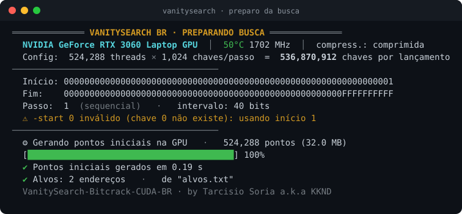
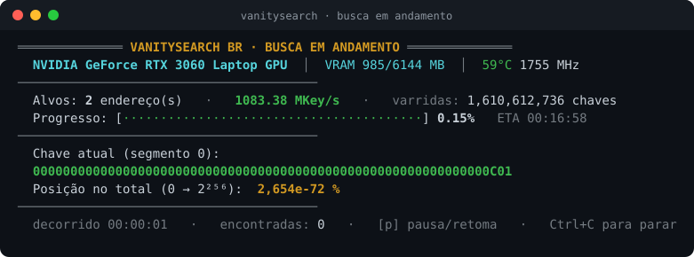
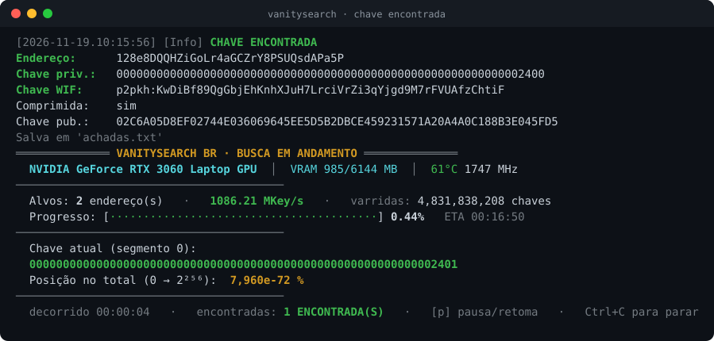

# VanitySearch-Bitcrack-CUDA-BR

> **Projeto derivado** do [VanitySearch](https://github.com/JeanLucPons/VanitySearch) de
> **Jean-Luc Pons**, via [VanitySearch-Bitcrack](https://github.com/FixedPaul/VanitySearch-Bitcrack)
> de **FixedPaul**. Não é um *fork* do GitHub: este repositório parte do histórico do projeto do
> FixedPaul e acrescenta o trabalho descrito abaixo.

Versão **BR (PT-BR)** do [VanitySearch-Bitcrack](https://github.com/FixedPaul/VanitySearch-Bitcrack)
(de **FixedPaul**), ferramenta CUDA de busca de chaves privadas Bitcoin por faixa (estilo puzzle).
Fork **educacional**, com o mesmo painel ao vivo, telemetria e idioma do
[BitCrack-BR](https://github.com/Tarcisio-Soria/BitCrack-BR).

O README original do projeto-base foi preservado em [`README.upstream.md`](README.upstream.md).

---

## ⚠️ Aviso

Projeto de uso **educacional e de pesquisa**. A finalidade é estudar o custo de busca por força
bruta e resolver os **puzzles públicos** do Bitcoin (endereços criados de propósito para serem
encontrados). Varrer chaves de carteiras de terceiros é **inviável** (o espaço de 256 bits é
astronômico) e **ilegal**. Use apenas em endereços que são seus ou nos puzzles públicos.

## Novidades da versão BR

- 🖥️ **Painel ao vivo em duas fases** (redesenhado no mesmo lugar):
  - **Preparo** — GPU, VRAM, temperatura/clock/fan, configuração, alvos válidos e ignorados,
    intervalo em bits, início/fim completos (64 hex) e **barra de progresso** na geração das
    chaves iniciais.
  - **Busca em andamento** — MKey/s, chaves varridas, barra de progresso + ETA, chave atual
    completa, posição no espaço total (0 → 2²⁵⁶), chaves encontradas.
- 🌡️ **Telemetria NVML** (NVIDIA): temperatura colorida conforme o limite de *throttle* lido da
  própria GPU, clock, fan e VRAM.
- 🇧🇷 **Mensagens e `--help` em português.**
- 🎯 **Multi-arquitetura**: SASS nativo para **sm_52, 61, 75, 80, 86, 89, 90 e 120**
  (Maxwell → Blackwell/RTX 50xx), escolhido conforme o CUDA instalado.
- Mantido do projeto-base: pausa/retomada com **`p`** (libera a GPU), **`-backup`**, **`-random`**,
  `-range` em potência de 2.

### Correções em relação ao projeto-base

- **Nenhuma chave era encontrada com gcc ≥ 12.** O código de hash herdado (SSE/RIPEMD160)
  calculava o hash160 errado na CPU, que descartava todo acerto da GPU
  (`wrong private key generated`). O `Makefile` agora compila com `-fno-strict-aliasing`.
- **`-start 0` nunca funcionava**: a chave 0 não existe e gerava pontos iniciais inválidos.
  Agora o início vira `1`, com aviso.
- **Endereço completo digitado errado era aceito em silêncio** (nunca seria encontrado). Agora
  o tamanho, a versão e o checksum são conferidos, e o item é ignorado com o motivo.
- **Cobertura do intervalo**: o passo de cada thread é arredondado para cima, para que um intervalo
  de tamanho qualquer não deixe chaves do fim sem varrer.
- **`-random`**: cada chave encontrada é mostrada e contada uma única vez.
- Velocidade não inicializada e divisão por zero no cálculo de progresso.
- `make` sem alvo agora compila o programa (antes só compilava o kernel).

> O arquivo de saída (`-o`) mantém o **formato original** (`Public Addr:` / `Priv (HEX):`) para não
> quebrar scripts; só o texto mostrado no terminal foi traduzido.

## Uso

```
vanitysearch [-v] [-gpuId N] [-i ARQUIVO] [-o ARQUIVO] [-start HEX] [-range BITS]
             [-m N] [-stop] [-random] [-backup] [ALVO]
```

| Opção | Descrição |
|---|---|
| `-start HEX` | chave privada inicial em hexadecimal, sem `0x` (`0` vira `1`) |
| `-range BITS` | varre `2^BITS` chaves, de `start` até `start + 2^BITS − 1` |
| `-i ARQUIVO` / `-o ARQUIVO` | lê a lista de alvos / grava as chaves encontradas |
| `-stop` | para quando **todos** os alvos forem encontrados |
| `-gpuId N` | GPU a usar (apenas uma por execução) |
| `-random` | modo aleatório (veja abaixo) |
| `-backup` | retoma o progresso da última busca sequencial (não vale para `-random`) |
| `p` (durante a busca) | pausa/retoma e libera a GPU |

O `-range` não é uma propriedade da chave: é **quanto você quer varrer** a partir do `-start`.
Cada +1 dobra o tempo (a ~900 MKey/s, `-range 36` leva cerca de 77 s).

Exemplos:

```
./vanitysearch -start 0 -range 36 ENDERECO                      # um endereço
./vanitysearch -i alvos.txt -start 4000000000 -range 38 -o achadas.txt   # lista
```

### Lista de alvos (`-i`)

Uma lista pode misturar itens diferentes:

- **endereços completos** (ex.: 34 caracteres): validados por tamanho e checksum — um endereço
  digitado errado é **ignorado com aviso**, não procurado;
- **prefixos mais curtos**: casam com qualquer endereço que comece assim;
- **tipos diferentes** (`1…`, `3…`, `bc1q…`): a busca usa **um tipo por vez**, o do primeiro item
  válido; os de outro tipo são ignorados.

O painel mostra só os alvos **válidos** e quantos foram ignorados. Os 5 primeiros motivos são
listados. Apenas endereços **comprimidos**.

### Modo `-random`

Sorteia posições dentro de `[start, start + 2^range)` e **nunca termina sozinho** (pare com
`Ctrl+C`). Não garante varrer tudo e só faz sentido em intervalos grandes: um lançamento varre
~2³⁰ chaves, então abaixo de 2⁴⁰ o painel avisa que o intervalo é pequeno demais.

### Varrer "para frente" sem fim

Não há `--keyspace` aberto como no BitCrack: o programa divide o intervalo entre as threads, então
um `-range` enorme não equivale a varrer em ordem a partir da chave. Faça janelas sucessivas, com o
`-start` de cada uma igual ao anterior somado a `2^range`.

## Exemplos

Substitua `ENDERECO` por um endereço seu (ou de um puzzle público) e `alvos.txt` pela sua lista.

```bash
# 1. Um endereço: de 1 até FFFFFFFFF (2^36 chaves, ~77 s a ~900 MKey/s)
./vanitysearch -start 0 -range 36 ENDERECO

# 2. Uma lista de endereços, salvando o que for encontrado
./vanitysearch -i alvos.txt -start 0 -range 36 -o achadas.txt

# 3. Parar assim que TODOS os alvos forem encontrados
./vanitysearch -i alvos.txt -start 0 -range 36 -stop -o achadas.txt

# 4. Começar de uma chave específica (hexadecimal, sem 0x): 2^36 chaves a partir de 2400
./vanitysearch -start 2400 -range 36 ENDERECO

# 5. Varrer "para frente" em janelas sucessivas de 2^36 chaves
#    (o -start de cada janela = anterior + 1000000000, que é 2^36 em hexadecimal)
./vanitysearch -start 2400       -range 36 ENDERECO
./vanitysearch -start 1000002400 -range 36 ENDERECO
./vanitysearch -start 2000002400 -range 36 ENDERECO

# 6. Intervalo de um puzzle de 40 bits: de 2^39 até 2^40 - 1
./vanitysearch -start 8000000000 -range 39 -o achadas.txt ENDERECO

# 7. Modo aleatório num intervalo grande (pare com Ctrl+C)
./vanitysearch -i alvos.txt -start 0 -range 44 -random -o achadas.txt

# 8. Retomar a última busca sequencial (o progresso é salvo a cada ~60 s)
./vanitysearch -i alvos.txt -start 0 -range 40 -backup -o achadas.txt

# 9. Escolher outra GPU
./vanitysearch -gpuId 1 -start 0 -range 36 ENDERECO
```

Durante a busca, `p` pausa e libera a GPU; apertar `p` de novo retoma.

### Como fica na tela

As imagens abaixo foram geradas a partir de execuções reais numa RTX 3060 Laptop, com dois alvos de
teste (um deles é a chave de teste `0x2400`). Os números variam conforme a GPU e a temperatura.

**Preparo da busca** — GPU, configuração, intervalo, avisos e alvos válidos:



**Busca em andamento** — o painel é redesenhado no mesmo lugar, sem rolar a tela:



**Chave encontrada** — o bloco aparece e o painel continua logo abaixo:



## Build (Linux)

```
make                       # detecta compilador (g++ mais novo) e arquiteturas do CUDA instalado
make CCBIN=g++-14          # força o compilador host
make NVML=0                # sem telemetria NVML (não exige libnvidia-ml)
make clean
```

- **CUDA Toolkit ≥ 11.8.** `sm_120` (RTX 50xx) entra com CUDA ≥ 12.8; `sm_52` sai com CUDA ≥ 13.
  Para um build mais rápido, deixe só a sua arquitetura em `GENCODE` no [`Makefile`](Makefile)
  (ex.: RTX 3060 = `sm_86`).
- O CUDA exige um gcc compatível com a versão instalada; se o detectado não servir, passe `CCBIN`.
- Com NVML, o link usa os *stubs* de `$(CUDA)/lib64/stubs`; em execução a biblioteca vem do
  driver (`libnvidia-ml.so`). No WSL ela fica em `/usr/lib/wsl/lib`.
- Em distros muito recentes, veja as notas de glibc/gcc no README do
  [BitCrack-BR](https://github.com/Tarcisio-Soria/BitCrack-BR).

### Testado

Linux (Ubuntu no WSL2), CUDA 12.9, gcc 14, RTX 3060 Laptop. O **build do Windows** (Visual Studio)
tem o novo módulo no projeto, mas **não foi testado**; a telemetria NVML não é ligada nele.

> Os binários pré-compilados que vinham com o projeto-base foram removidos deste repositório:
> compile a partir do código-fonte.

## Estrutura do que foi adicionado

| Arquivo | Papel |
|---|---|
| [`PainelBR.h`](PainelBR.h) / [`PainelBR.cpp`](PainelBR.cpp) | painel, barras, formatação e NVML — módulo independente do motor de busca |
| `Vanity.cpp` (`FindKeyGPU`, `PrintStats`, `getGPUStartingKeys`, `initAddress`) | integração do painel, cobertura do intervalo e validação dos alvos |
| `main.cpp`, `Makefile` | ajuda em PT-BR, banner, multi-arch, NVML, detecção de compilador e CUDA |

## Créditos

- **[Jean-Luc Pons](https://github.com/JeanLucPons/VanitySearch)** — autor do VanitySearch original.
- **[FixedPaul](https://github.com/FixedPaul/VanitySearch-Bitcrack)** — adaptação estilo BitCrack e
  otimizações CUDA (base deste fork).
- **Tarcisio Soria (KKND)** — adaptação BR: painel, telemetria, tradução, correções e
  multi-arquitetura.

## Licença

**GNU Affero General Public License v3.0** (ou posterior) — veja [`LICENSE.txt`](LICENSE.txt).
Diferente do [BitCrack-BR](https://github.com/Tarcisio-Soria/BitCrack-BR) (MIT), este fork é
**copyleft** porque deriva de código AGPL; quem distribuir ou oferecer o programa em rede deve
disponibilizar o código-fonte, incluindo as modificações.
